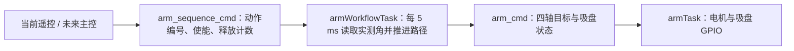

# 机械臂主控调用与接入手册

本手册对应当前代码。`controlTask` 暂用遥控器 SA/SB/SC/SD 产生动作请求；独立的 `armWorkflowTask` 每 5 ms 规划并发布四轴目标。未来接主控时，替换动作请求的发送方即可，机械臂规划任务不需要改。

## 1. 代码分工



| 位置 | 职责 |
| --- | --- |
| [arm_solution.hpp](arm_solution.hpp)、[arm_solution.cpp](arm_solution.cpp) | 坐标系、正逆解、直线/圆弧、限位和杆尾禁区 |
| [arm_workflow.hpp](arm_workflow.hpp) | 根据动作 ID 每 5 ms 推进一条路径，给出四轴目标与吸盘状态 |
| [control_task.cpp](../control_task/control_task.cpp) | 当前遥控输入适配器，发布 `arm_sequence_cmd`；不调用逆解或电机 |
| [arm_workflow_task.cpp](arm_workflow_task.cpp) | 唯一的工作流调用者和 `arm_cmd` 发布者；每 5 ms 执行一次 |
| [arm_task.cpp](arm_task.cpp) | 订阅 `arm_cmd`，执行上电定位、四轴控制和吸盘 GPIO |
| [arm_djmotor.cpp](arm_djmotor.cpp) | ROTATE、EXTEND 的 DJI 电机位置/速度环 |

主控发送的是**动作请求**，不是四轴角度。`arm_cmd` 是规划任务给 `armTask` 的内部消息。未来接主控时，应由主控接收任务取代遥控适配器，成为 `arm_sequence_cmd` 的唯一发布者。

## 2. 上电与允许启动的条件

1. `robot_task.cpp` 创建 `controlTask`、`armWorkflowTask`、`armTask` 和 `ArmDJMotorTask`。
2. `armTask` 等到 LIFT、FLIP 收到首帧反馈后，分别向机械零位和 `FLIP = -90°` 定位。`armStartupPositionReady()` 为 `true` 后，自动路径才可以启动。
3. 四轴都收到过反馈时，`armFeedbackSampled()` 为 `true`。主控接入时还应根据项目的离线判断决定是否允许执行；`armFeedbackReady()` 可检查四轴当前是否离线。
4. `armWorkflowTask` 读取四轴实测角，检查上电就绪、反馈及数值，再决定 `arm_cmd.enable`。使能为 `false` 时，`armTask` 不执行路径目标。

机械臂上电后不要假定末端已经位于路径表的首点。每次新动作都以启动时的**实测关节角**作为起点。

## 3. 主控需要发送的命令

发布 [arm_sequence_cmd](../robot_task/topic_pool.h) 到 `arm_sequence_cmd` Topic。当前发布者是遥控 `controlTask`；主控接入时替换这个发布者。它是板内消息，不限定主控的 CAN/串口字节格式：

| 字段 | 含义 |
| --- | --- |
| `sequence_id` | `0=START`、`1=FETCH`、`2=HOLD`、`255=INVALID_PATH`（停止/保持） |
| `enable` | 是否允许机械臂执行路径目标 |
| `release_count` | 每次释放递增一次；规划任务检测到变化后调用 `releaseSuction()` |

`Arm::Translator(uint8_t sequence_id, PATH& path)` 负责把 `0/1/2` 转成 `START/FETCH/HOLD`，未知编号返回 `INVALID_PATH`。它只**解析编号**，不读总线、不启动电机。当前 `PATH` 见 [arm_solution.hpp](arm_solution.hpp)：`START=0`、`FETCH=1`、`HOLD=2`、`INVALID_PATH=255`。

主控动作命令的建议调用顺序：

```text
START              → 等待 START Complete
底盘移动到拾取位置 → 等待底盘完成
INVALID_PATH 一周期 → FETCH → 等待 FETCH Complete，吸盘保持吸取
底盘按任务需要移动 → 等待底盘完成
INVALID_PATH 一周期 → HOLD → 等待 HOLD Complete，吸盘继续吸取
release_count + 1  → 吸盘释放，保持机械臂目标位置
```

三个动作已分开，`START` 完成**不会**自动进入 `FETCH`，`FETCH` 完成**不会**自动进入 `HOLD`。底盘移动时保持前一个动作的最终目标即可。

## 4. 当前遥控与未来主控如何接入

当前 [control_task.cpp](../control_task/control_task.cpp) 把遥控器映射为 `arm_sequence_cmd`：SA 向下允许运动，SD 向下使 SB 的上/中/下对应 START/FETCH/HOLD，SD 松开传 255，SC 切到中位使 `release_count` 增加。它只发布动作请求，不读取关节、不算逆解、不发布电机命令。

独立的 [arm_workflow_task.cpp](arm_workflow_task.cpp) 订阅这个 Topic，持续每 5 ms 调用 `getangles()`、`Arm::Translator()`、`workflow.update()`，再发布 `arm_cmd`。它检查上电定位完成、四轴反馈和实测角有效性；请求超过 100 ms 未更新会撤销使能。`armTask` 继续订阅 `arm_cmd` 控制电机和吸盘 GPIO。

未来主控接入时，让通信接收任务发布同样的 `arm_sequence_cmd`，停止遥控 `controlTask` 对该 Topic 的发布，避免两个命令源互相覆盖。主控只需要提供动作编号、使能和释放计数；规划周期与电机目标发布已封装在机械臂任务里。四轴速度上限仍是 `1500°/s`，现在定义在 `arm_workflow_task.cpp`，路径时间未改。

当前同 MCU 的其他任务仍可调用 [requestArmReleaseKFS()](../control_task/control_task.h)：遥控适配器会把计数放入下一条消息。未来若停用遥控适配器，主控接收任务应自行维护 `release_count`。不要直接调用 `arm.releaseKFS()`：下一周期的 `arm_cmd` 会重新写 GPIO。

## 5. 新动作如何触发

`ArmWorkflow::update()` 只在请求从 `INVALID_PATH` 变为有效路径时启动一次。**直接把有效编号从 `START` 改成 `FETCH`，不会启动 FETCH。** 当前遥控测试应先松开 SD 至少一个规划周期，再切换 SB 并按下 SD。未来主控发送下一条动作前，应先发布至少一个规划周期的 `INVALID_PATH`：

```text
发布 sequence_id=255（至少一个 5 ms 规划周期）
然后持续发布 sequence_id=1（FETCH）
```

持续重复发布相同编号不会重新启动。正在 `Running` 时不要直接抢占另一条路径。`sequence_id=255` 会停止推进并保持最后目标，**不会自动释放吸盘**。

主控如果只发一次动作命令，接收任务必须把路径 ID **锁存**并持续发布；仅传一个周期有效 ID、随后传 255，会刚启动就停止。主控链路断开时，接收任务应撤销使能；规划任务有 100 ms 请求超时，`armTask` 还保留 100 ms 内部 `arm_cmd` 超时处理。

## 6. 完成、故障与释放

状态由 `ArmWorkflow::state()` 返回：

| 数值 | 状态 | 主控处理 |
| --- | --- | --- |
| `0` | `Hold` | 等待命令或已停止路径；不能当作动作完成 |
| `2` | `Running` | 继续等待、持续发送本地锁存的路径 ID |
| `3` | `Complete` | 当前 `path()` 对应的动作完成，可推进主控任务 |
| `4` | `Fault` | 停止后续动作，读取 `fault()` 与 `failureReason()` |

未来建议由 `armWorkflowTask` 回报 `path()`、`state()`、`fault()`、`failureReason()`、`segment()`、`progress()`、`suctionOn()`，接收任务可关联主控命令编号。**当前尚未实现主控状态回报 Topic。** `progress()==1` 仅说明轨迹插值到终点，不等于电机已经满足到位条件；以 `Complete` 为准。

`FETCH` 末端实测角到位后才开启吸盘，并等待约 0.5 s 后进入 `Complete`；`HOLD` 沿圆弧运行时保持吸盘。`ReleaseKFS` 会清除吸盘状态；若路径还在 `Running`，会把它停止在 `Hold`。释放完成后若要执行新动作，仍按第 5 节插入无效路径周期。

`arm_cmd.enable=false` 时，当前 `armTask` 会释放吸盘并保持关节；但 `ArmWorkflow` 内部的吸盘状态不会因此自动清零。若需要**重使能后仍保持释放**，应明确发送 `ReleaseKFS`，不能只依赖关闭使能。

## 7. 路径和时间在哪里调整

| 项目 | 当前实际生效位置 |
| --- | --- |
| START 两段终点 | [arm_solution.hpp](arm_solution.hpp) 的 `start_path` |
| FETCH 圆弧终点与方向 | 同文件的 `fetch_path`、`kFetchEndDirectionDeg`、`kFetchEndLiftDeg` |
| HOLD 圆弧终点与经过点 | 同文件的 `hold_path`、`kHoldArcVia` |
| START 时间 | [arm_workflow.hpp](arm_workflow.hpp)：第 1 段 1 s，第 2 段 2.5 s |
| FETCH 时间 | 同文件：先调整朝向 2 s，圆弧 5 s，吸取等待约 0.5 s |
| HOLD 时间 | 同文件：圆弧名义 6 s |
| 电机速度上限 | [arm_workflow_task.cpp](arm_workflow_task.cpp) 的 `kMotorSpeedDegPerSec` |

上述时间为名义值；跟随误差过大时，工作流会暂停进度等待电机，实际时间可能更长。`arm_pathsequences::start_pathsteps/fetch_pathsteps/holding_pathsteps` 虽然也在 `arm_solution.hpp`，**目前没有接入执行器**，改其中的时间或终点不会改变实机路径。

## 8. 交接前核对

1. 确认主控接收任务是 `arm_sequence_cmd` 的唯一发布者，`armWorkflowTask` 是 `arm_cmd` 的唯一发布者。
2. 用主控消息替换 SA/SB/SC/SD 映射，保持动作请求连续发布；5 ms 规划与使能/反馈检查留在机械臂任务。
3. 验证重复发布相同路径不重启；新动作之间确实经过一个 `INVALID_PATH` 周期。
4. 验证 START、FETCH、HOLD 逐段返回 `Complete`，故障时主控停止后续动作。
5. 验证 FETCH 吸取、HOLD 保持、ReleaseKFS 持续释放；验证主控断链与 `arm_cmd` 超时后的行为。
6. 如果因为而导致DM4310（吸盘连接的那台电机），可适当调节'kFetchEndDirectionDeg'arm_solution.hpp 第154行
/**
 * @file control_task.cpp
 * @author 大帅将军 / lxlx
 * @brief
 * @version 0.3
 * @date 2026-05-28
 *
 * @copyright Copyright (c) 2026
 *
 * @attention
 * @note 
 */

#include "main.h"
#include "control_task.h"
#include "pid_controller.h"
#include "chassis_task.h"
#include "rm_pocket.hpp"
#include "topic_pool.h"
#include "topics.hpp"
#include "bsp_usart.h"
#include "tracking.h"

#include <cstdint>
#include <atomic>

#include "control_Traject.hpp"
#include "Motor.hpp"

osThreadId_t ControlTaskHandle;

static std::atomic<uint32_t> arm_release_count{0U};

void requestArmReleaseKFS() {
    arm_release_count.fetch_add(1U, std::memory_order_relaxed);
}

// ===== 发布者 =====
TypedTopicPublisher<pub_chassis_cmd> chassis_data_pub("chassis_cmd");
pub_chassis_cmd rm_cmd{};

// static TypedTopicPublisher<QR_code_cmd_t> qr_code_cmd_pub("qr_code_cmd");   
// static QR_code_cmd_t qr_code_cmd{};

TypedTopicSubscriber<pub_RM_Data> control_rm_sub("rm", 8);
pub_RM_Data control_rm_cmd{};

TypedTopicSubscriber<pub_Position_Data> control_position_sub("position", 8);
pub_Position_Data control_position_msg{};
pub_Position_Data control_position{};

pub_chassis_cmd robot_v_aim_cmd{};
pub_chassis_cmd state_now_cmd{};

extern VESCMotor U8_3;
int32_t U8_3_erpm = 0;

TypedTopicPublisher<arm_sequence_cmd> arm_sequence_cmd_pub("arm_sequence_cmd");


void controlInit() {
    if (!chassis_data_pub.IsValid()) {
        return;
    }

    if (!control_rm_sub.IsValid()) {
        return;
    }

    if (!control_position_sub.IsValid()) {
        return;
    }
    // if (!control_ir_sub.IsValid()) {
    //     return;
    // }
    // if(!qr_code_cmd_pub.IsValid()) {
    //     return;
    // }
    // if(!qr_code_data_sub.IsValid()) {
    //     return;
    // }
    if(!arm_sequence_cmd_pub.IsValid()){
        return;
    }
}


float rm_angle_deg;
float v_aim;

void controlTask(void *argument) {
    TickType_t currentTime = xTaskGetTickCount();
    TickType_t rcUpdateTime = currentTime;
    constexpr TickType_t kRemoteInputTimeout = pdMS_TO_TICKS(500);
    bool remote_received = false;
    bool sc_initialized = false;
    bool sc_was_middle = false;


    controlInit();
    // uint32_t last_time = HAL_GetTick();
    control_rm_cmd.joyLHori = kJoyCenter;
    control_rm_cmd.joyLVert = kJoyCenter;
    control_rm_cmd.joyRHori = kJoyCenter;
    control_rm_cmd.joyRVert = kJoyCenter;
    for (;;) {
        // static float controlTask_dt = 0.0f;
        // static uint32_t controlTask_DWT_CNT = 0;
        // controlTask_dt = DWT_GetDeltaT(&controlTask_DWT_CNT);

        //test begin
        const TickType_t now = xTaskGetTickCount();
        while (control_rm_sub.TryGet(&control_rm_cmd)) {
            rcUpdateTime = now;
            remote_received = true;
        }
        if (remote_received && now - rcUpdateTime <= kRemoteInputTimeout) {
            const bool sc_middle =
                control_rm_cmd.swC == RM_3_POS_SW_State_t::MIDDLE;
            if (sc_initialized && sc_middle && !sc_was_middle) {
                requestArmReleaseKFS();
            }
            sc_was_middle = sc_middle;
            sc_initialized = true;
        } else {
            sc_initialized = false;
        }
        const bool auto_mode = control_rm_cmd.swD == RM_2_POS_SW_State_t::DOWN;
        uint8_t test_sequence_id = 255U;
        if (auto_mode && remote_received &&
            now - rcUpdateTime <= kRemoteInputTimeout) {
            switch (control_rm_cmd.swB) {
                case RM_3_POS_SW_State_t::UP:     test_sequence_id = 0U; break;
                case RM_3_POS_SW_State_t::MIDDLE: test_sequence_id = 1U; break;
                case RM_3_POS_SW_State_t::DOWN:   test_sequence_id = 2U; break;
                default: break;
            }
        }
        const bool remote_fresh = remote_received &&
            now - rcUpdateTime <= kRemoteInputTimeout;
        if (!remote_received || now - rcUpdateTime > kRemoteInputTimeout) {
            control_rm_cmd.joyLHori = kJoyCenter;
            control_rm_cmd.joyLVert = kJoyCenter;
            control_rm_cmd.joyRHori = kJoyCenter;
            control_rm_cmd.joyRVert = kJoyCenter;

        }
        /*
        {
            rm_cmd.linear_x_ = JoyToVelocity(control_rm_cmd.joyLHori, kJoyDeadZoneLeft, MAX_VELOCITY_LINEAR);
            rm_cmd.linear_y_ = JoyToVelocity(control_rm_cmd.joyLVert, kJoyDeadZoneLeft, MAX_VELOCITY_LINEAR);
            rm_cmd.omega_    = -JoyToVelocity(control_rm_cmd.joyRHori, kJoyDeadZoneRight, MAX_VELOCITY_ANGULAR);

            rm_angle_deg = atan2(rm_cmd.linear_y_, rm_cmd.linear_x_) / kDegToRad;
            v_aim = sqrt(rm_cmd.linear_x_ * rm_cmd.linear_x_ + rm_cmd.linear_y_ * rm_cmd.linear_y_);
            robot_v_aim_cmd.linear_x_ = v_aim * cos((rm_angle_deg - state_now_cmd.omega_) * kDegToRad);
            robot_v_aim_cmd.linear_y_ = v_aim * sin((rm_angle_deg - state_now_cmd.omega_) * kDegToRad);
            robot_v_aim_cmd.omega_ = rm_cmd.omega_;    
        }

        U8_3.setMotorCtrl(U8_3_erpm, VESCMotor::VESC_MODE::SET_ERPM);

        chassis_data_pub.Publish(robot_v_aim_cmd);
        */

        const arm_sequence_cmd arm_request{
            test_sequence_id,
            remote_fresh && control_rm_cmd.swA == RM_2_POS_SW_State_t::DOWN,
            arm_release_count.load(std::memory_order_relaxed)
        };
        arm_sequence_cmd_pub.Publish(arm_request);

        vTaskDelayUntil(&currentTime, pdMS_TO_TICKS(5));
    }
}

/**
 * @file control_task.h
 * @author 大帅将军
 * @brief
 * @version 0.1
 * @date 2026-04-21
 *
 * @copyright Copyright (c) 2026
 *
 * @attention :
 * @note :
 * @versioninfo :
 */
#pragma once

#include "FreeRTOS.h"
#include "cmsis_os.h"
#include "task.h"
#include "topics.hpp"
#include "topic_pool.h"

#define MAX_VELOCITY_LINEAR 1.5f // 最大速度，单位m/s，根据实际情况调整
#define MAX_VELOCITY_ANGULAR 3.14f // 最大速度，单位rad/s，根据实际情况调整

#define MAX_POSITION 1200.0f

void controlInit();

void controlTask(void *argument);

// Request a persistent suction release from another task.
void requestArmReleaseKFS();
